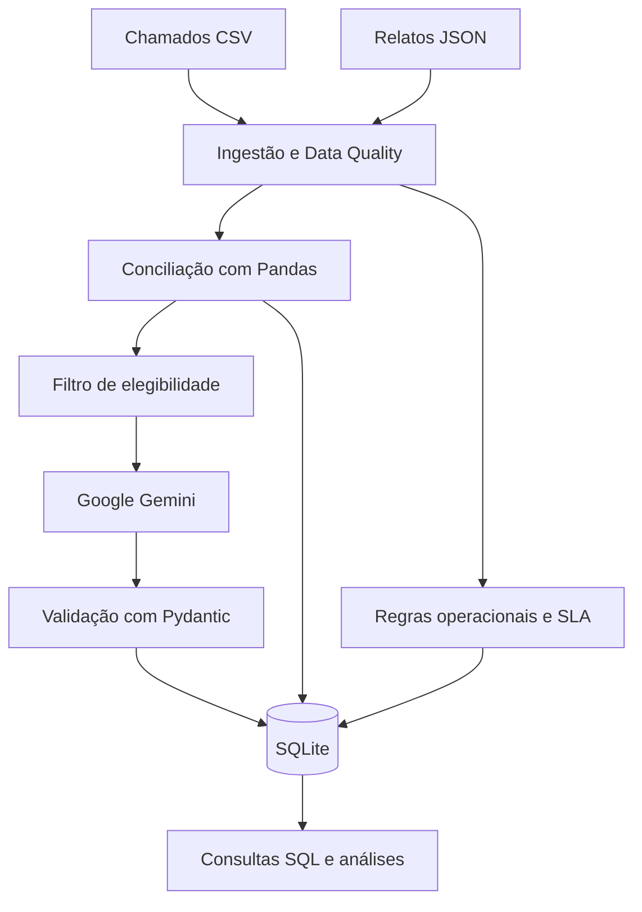

# 🤖 OpsMail AI
### Intelligent Service Operations Pipeline

Pipeline de Engenharia de Dados com Inteligência Artificial para integração de chamados de TI, análise de relatos operacionais e identificação de possíveis divergências.

O projeto combina **Python, Pandas, Google Gemini, Pydantic e SQLite** para transformar dados estruturados e informações narrativas em resultados organizados, rastreáveis e consultáveis.

> **Status:** MVP funcional — em evolução.

---

## 📌 Sobre o projeto

Em operações de TI, informações importantes frequentemente ficam distribuídas entre sistemas de chamados e atualizações narrativas realizadas pelas equipes técnicas.

Essa separação pode dificultar a identificação de pendências, o acompanhamento de prazos e a análise da situação operacional dos chamados.

O **OpsMail AI** foi desenvolvido como um projeto de Engenharia de Dados para explorar uma solução para esse problema.

O sistema integra duas fontes de dados:

- **CSV:** informações estruturadas dos chamados.
- **JSON:** relatos narrativos associados aos chamados.

A partir dessas fontes, o pipeline executa validações de qualidade, concilia registros, calcula indicadores operacionais e utiliza Inteligência Artificial para extrair informações relevantes dos textos.

Os resultados são armazenados em um banco de dados SQLite.

**Todos os dados utilizados são sintéticos e destinados exclusivamente à demonstração.**

---

## 🏗️ Arquitetura



### Etapas do pipeline

1. **Ingestão:** leitura de arquivos CSV e JSON.
2. **Data Quality:** validação de identificadores, datas e campos obrigatórios.
3. **Conciliação:** relacionamento entre chamados e relatos utilizando Pandas.
4. **Regras operacionais:** identificação de prazos expirados, chamados antigos e registros desatualizados.
5. **Inteligência Artificial:** interpretação dos relatos utilizando Google Gemini.
6. **Validação:** padronização das respostas com Pydantic.
7. **Persistência:** armazenamento dos dados originais e derivados no SQLite.
8. **Verificação:** consultas SQL e testes automatizados.

---

## ⚙️ Tecnologias utilizadas

| Tecnologia | Aplicação |
|---|---|
| Python | Linguagem principal do pipeline |
| Pandas | Ingestão, tratamento e conciliação |
| Google Gemini API | Extração de informações narrativas |
| Pydantic | Validação estrutural das respostas de IA |
| SQLite | Persistência relacional |
| SQL | Consulta e análise dos resultados |
| Pytest | Testes automatizados |
| Git e GitHub | Versionamento e publicação |

---

## 🔍 Funcionalidades

### 1. Data Quality

O sistema verifica inconsistências nos arquivos de origem.

Entre as validações implementadas estão:

- Identificadores inválidos ou duplicados.
- Datas ausentes ou inválidas.
- Última atualização anterior à abertura do chamado.
- Campos obrigatórios dos relatos sem preenchimento.
- Relatos com datas anteriores à abertura dos chamados.

Os registros problemáticos são preservados para auditoria, evitando a perda silenciosa de informações.

### 2. Conciliação de dados

Os relatos são relacionados aos chamados por meio da coluna `chamado_id`.

O pipeline identifica diferentes situações:

- Chamado encontrado.
- Chamado inexistente na origem.
- Identificador duplicado na origem.
- Identificador ausente no relato.

A conciliação utiliza operações de `merge()` do Pandas com validação da cardinalidade esperada.

### 3. Indicadores operacionais

O sistema calcula três indicadores iniciais:

| Indicador | Critério |
|---|---|
| Prazo expirado | Chamado ativo, não pausado e com prazo informado anterior à referência |
| Sem atualização há mais de 5 dias | Chamado ativo com última atualização anterior ao limite |
| Aberto há mais de 30 dias | Chamado ativo cuja abertura ultrapassa o limite |

Os indicadores distinguem registros avaliáveis daqueles que apresentam problemas de qualidade.

**Importante:** um prazo expirado não representa, necessariamente, uma violação contratual comprovada de SLA.

### 4. Análise de relatos com IA

O Google Gemini interpreta o conteúdo narrativo e extrai informações estruturadas.

O modelo de saída contém:

```json
{
  "resumo": "Serviço restabelecido após intervenção técnica.",
  "situacao_reportada": "solucionado",
  "pendencia": null,
  "proxima_acao": null,
  "impacto_mencionado": null
}
```

As respostas passam por validação estrutural com Pydantic antes da persistência.

O pipeline também seleciona os relatos elegíveis para análise, evitando encaminhar automaticamente registros que apresentem determinados problemas de qualidade.

**A IA não modifica os chamados originais nem determina automaticamente violações de SLA.**

Suas interpretações são informações de apoio e podem exigir revisão humana.

---

## 🗄️ Banco de dados

O projeto utiliza SQLite, com persistência local no arquivo `opsmail.db`.

### Tabelas

| Tabela | Conteúdo |
|---|---|
| `raw_chamados` | Registros originais dos chamados |
| `raw_relatos` | Relatos narrativos originais |
| `conciliacao` | Associações e validações de qualidade |
| `indicadores_operacionais` | Indicadores calculados em Python |
| `analises_ia` | Informações extraídas pelo Gemini |

### Exemplo de consulta SQL

```sql
SELECT
    chamado_id,
    status,
    situacao_prazo
FROM indicadores_operacionais
WHERE situacao_prazo = 'prazo_expirado';
```

Essa consulta identifica os chamados classificados pelo motor de regras como possuindo prazo informado expirado.

---

## 📂 Estrutura do projeto

```text
opsmail-ai/
│
├── data/
│   ├── raw/
│   │   ├── chamados.csv
│   │   └── relatos.json
│   │
│   └── processed/
│       └── (arquivos gerados durante a execução)
│
├── src/
│   ├── analisar_relatos.py
│   ├── conciliar.py
│   ├── executar_pipeline.py
│   ├── inspecionar_chamados.py
│   ├── inspecionar_relatos.py
│   ├── modelos_ia.py
│   ├── persistir_sqlite.py
│   ├── regras_operacionais.py
│   ├── testar_gemini.py
│   └── verificar_pipeline.py
│
├── tests/
│   └── test_pipeline.py
│
├── .env.example
├── .gitignore
├── README.md
└── requirements.txt
```

Os arquivos processados e o banco SQLite são gerados localmente e não são versionados.

---

## 🚀 Como executar

### Pré-requisitos

- Python 3.14 (versão utilizada no desenvolvimento).
- Git.
- Chave da API do Google Gemini para utilizar a funcionalidade de IA.

### 1. Clonar o repositório

```bash
git clone https://github.com/SEU-USUARIO/opsmail-ai.git
cd opsmail-ai
```

Substitua `SEU-USUARIO` pelo usuário responsável pelo repositório.

### 2. Criar o ambiente virtual

```powershell
python -m venv .venv
```

No Windows PowerShell:

```powershell
.venv\Scripts\Activate.ps1
```

### 3. Instalar as dependências

```powershell
python -m pip install -r requirements.txt
```

### 4. Configurar a API do Gemini

Crie um arquivo `.env` na raiz do projeto a partir do `.env.example`.

```env
GEMINI_API_KEY=SUA_CHAVE_AQUI
```

Uma chave pode ser obtida pelo Google AI Studio:

https://aistudio.google.com/apikey

A utilização da API depende dos limites, da disponibilidade do modelo configurado e das condições de cobrança do projeto Google.

**Nunca publique credenciais no GitHub.**

### 5. Executar o pipeline

Para executar o processamento de dados sem novas chamadas à IA:

```powershell
python src/executar_pipeline.py
```

Para executar o pipeline completo, incluindo análise com Gemini:

```powershell
python src/executar_pipeline.py --com-ia
```

A execução completa realiza as etapas sequencialmente, gera os arquivos processados e atualiza as tabelas SQLite.

### 6. Executar os testes

Depois de executar o pipeline completo:

```powershell
python -m pytest tests/ -v
```

Os testes atuais validam a estrutura e os resultados esperados da base sintética de demonstração.

---

## 📊 Resultados iniciais

Nos testes funcionais do MVP, foram utilizados cinco chamados e oito relatos sintéticos.

| Métrica | Resultado |
|---|---:|
| Chamados processados | 5 |
| Relatos recebidos | 8 |
| Relatos associados por identificador | 5 |
| Relatos elegíveis à análise de IA | 2 |
| Análises realizadas pelo Gemini | 2 |
| Tabelas persistidas no SQLite | 5 |
| Testes automatizados iniciais | 3 aprovados |

### Exemplo de resultado

Um dos relatos informa que os serviços foram restabelecidos, enquanto o cadastro do chamado continua com status `em_andamento`.

O pipeline permite visualizar essas informações conjuntamente, tornando possível investigar uma eventual divergência.

Essa diferença, isoladamente, não comprova erro cadastral: é necessário considerar a cronologia e o contexto dos registros.

---

## 🧪 Testes e confiabilidade

O projeto possui testes iniciais com Pytest para verificar:

- Presença das colunas esperadas no relatório de conciliação.
- Identificação de inconsistências temporais previamente conhecidas.
- Quantidades esperadas de registros nas tabelas SQLite.

A execução integrada também foi verificada utilizando o orquestrador `executar_pipeline.py`.

Os testes atuais representam uma cobertura inicial e não substituem uma suíte completa de testes unitários e de integração.

---

## 🔐 Segurança e privacidade

O projeto utiliza arquivos sintéticos de demonstração.

As credenciais da API são carregadas de variáveis de ambiente, utilizando `python-dotenv`.

O `.gitignore` impede o versionamento habitual de:

- Arquivos `.env`.
- Ambiente virtual `.venv`.
- Arquivos temporários Python.
- Bancos de dados e resultados processados.
- Configurações locais do PyCharm.

O projeto não deve ser utilizado com dados reais de clientes sem avaliação prévia dos requisitos de segurança, privacidade e governança.

---

## ⚠️ Limitações do MVP

O OpsMail AI é um protótipo educacional e demonstrativo.

Atualmente:

- Os relatos são fornecidos por JSON, sem integração real com caixas de e-mail.
- As regras operacionais utilizam uma data de referência fixa para testes reproduzíveis.
- As tabelas derivadas podem ser substituídas em execuções posteriores.
- A execução sem IA não atualiza automaticamente a tabela de análises anteriores.
- O filtro de elegibilidade e as regras de qualidade ainda podem ser ampliados.
- A IA pode realizar inferências que não estejam explicitamente sustentadas pelos relatos.
- Ainda não existe uma interface gráfica para visualização.
- Os testes automatizados possuem cobertura inicial limitada.

O projeto não é destinado ao uso em produção nesta versão.

---

## 🛣️ Próximas evoluções

- Ampliar a cobertura dos testes automatizados.
- Implementar histórico de execuções e análises.
- Melhorar a rastreabilidade das informações extraídas pela IA.
- Desenvolver mecanismos de revisão humana de divergências.
- Ampliar as validações e regras operacionais.
- Avaliar ingestão de atualizações diretamente de e-mails.
- Criar dashboards operacionais para visualização dos indicadores.

---

## 🎯 Objetivo de desenvolvimento

O OpsMail AI foi desenvolvido como projeto prático de aprendizado e portfólio, com foco na aplicação conjunta de conceitos de:

**Engenharia de Dados, Python, integração de fontes, qualidade de dados, SQL e Inteligência Artificial aplicada a operações de TI.**

---

**OpsMail AI — Intelligent Service Operations Pipeline**

*Transformando dados operacionais e relatos narrativos em informações estruturadas para apoiar decisões.*
